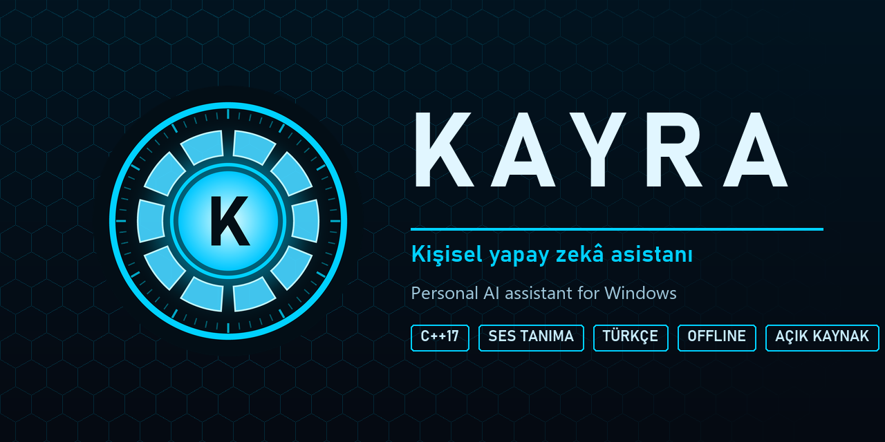
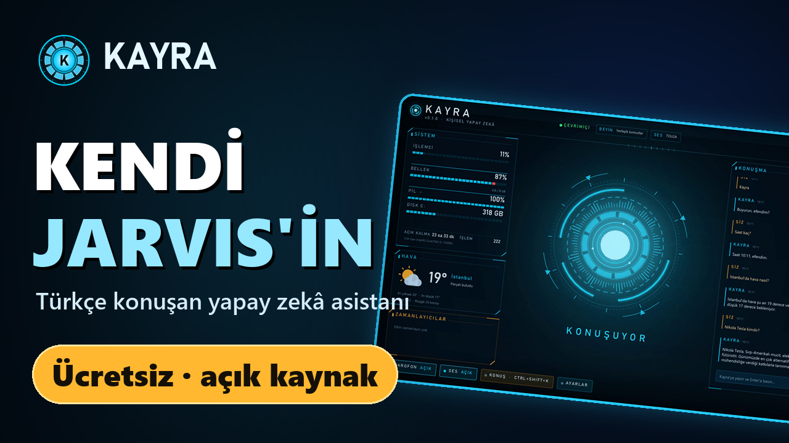
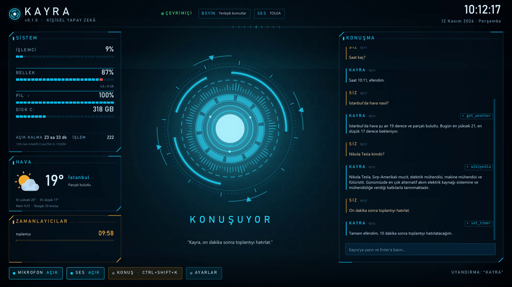
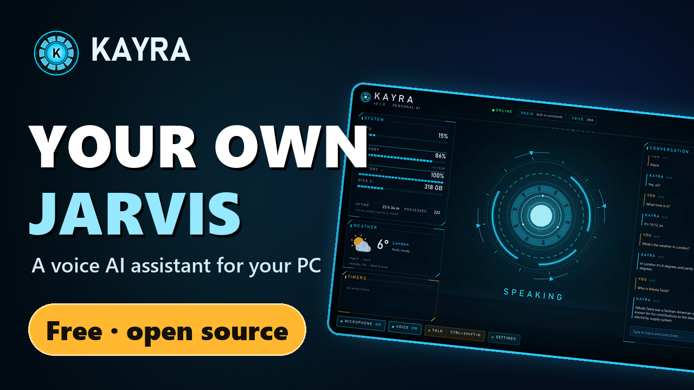
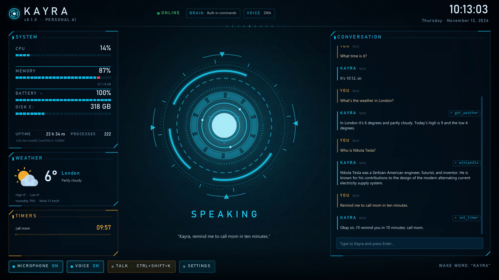

<p align="center">
  
</p>

<p align="center">
  <b>Bilgisayarınız için kişisel yapay zekâ asistanı · A personal AI assistant for your PC</b><br>
  C++17 · Windows 10/11 · Türkçe &amp; English · ses tanıma cihazda / on-device speech recognition
</p>

<p align="center">
  <a href="https://github.com/Hydra-Ai-tr/kayra/releases/latest">İndir / Download</a> ·
  <a href="#türkçe">Türkçe</a> ·
  <a href="#english">English</a> ·
  <a href="LICENSE">PolyForm Noncommercial 1.0.0</a>
</p>

---

## Türkçe

**Kayra**, Tony Stark'ın JARVIS'inden ilham alan, Windows için yazılmış bir sesli asistandır. "Kayra" deyin, isteğinizi söyleyin: saati, havayı, Wikipedia'dan bilgiyi söyler; uygulama ve site açar, YouTube'da arar, hatırlatma kurar, hesap yapar, sizi hatırlar. Ses tanıma tamamen bilgisayarınızda çalışır ([whisper.cpp](https://github.com/ggml-org/whisper.cpp)); sesiniz hiçbir yere gönderilmez.

### Tanıtım videosu

[](video/kayra-tanitim-tr.mp4)

Videodaki tüm uygulama görüntüleri gerçek kayıttır: uygulamanın kendisi, Kayra'nın kendi sesiyle (`kayra.exe --record`). İngilizce sürüm: [video/kayra-tanitim-en.mp4](video/kayra-tanitim-en.mp4).



### Neler yapabilir?

| | |
|---|---|
| **Sesle kontrol** | "Kayra" uyandırma kelimesi, her yerden **Ctrl+Shift+K**, cevaptan sonra uyandırma kelimesi olmadan devam |
| **Bilgi** | Saat ve tarih, hava durumu (konumu kendisi bulur), Wikipedia özetleri, sistem durumu |
| **Uygulamalar** | Başlat menüsündeki her uygulamayı adıyla açar ("Spotify'ı aç", "indirilenler klasörünü aç"), siteler, Google / YouTube / Haritalar araması |
| **Medya** | Ses seviyesi, oynat / duraklat / sonraki, "Tarkan şarkısı aç" |
| **Zamanlayıcı** | "10 dakika sonra toplantıyı hatırlat", "bir buçuk saat sonra…", ekranda geri sayım |
| **Hesap** | "240'ın yüzde 15'i", "kök 144 artı 3 üzeri 2", "5'in karesi", "125 çarpı 48" |
| **Hafıza** | "Şunu hatırla: kahvemi şekersiz içerim", adınızı ve size nasıl hitap edeceğini bilir |
| **Bilgisayar** | Ekran görüntüsü, kilitleme, kapatma / yeniden başlatma / uyku (onay ister), pano okuma |
| **Yapay zekâ beyni** | İsteğe bağlı: OpenAI uyumlu her API ile serbest sohbet ve araç kullanımı |

Beyin bağlı olmadan da çalışır: yerleşik komut ayrıştırıcısı Türkçe ve İngilizce cümleleri internetsiz anlar. Beyin bağlıyken Kayra serbest sohbet eder ve yukarıdaki araçları kendisi çağırır.

### Yapay zekâ beyni

Ayarlar → Beyin sekmesinden seçin:

| Sağlayıcı | Adres | Not |
|---|---|---|
| Yerleşik komutlar | – | internetsiz, varsayılan |
| [Ollama](https://ollama.com) | `http://127.0.0.1:11434/v1` | yerel, örn. `qwen2.5:7b` |
| [LM Studio](https://lmstudio.ai) | `http://127.0.0.1:1234/v1` | yerel |
| [Kor Studio](https://github.com/Hydra-Ai-tr/kor-studio) | `http://127.0.0.1:8765/v1` | yerel, `kor-cli serve` |
| OpenAI, Google Gemini, Groq, OpenRouter | bulut | API anahtarı gerekir |
| Özel | herhangi bir OpenAI uyumlu adres | |

### Kurulum

1. [Sürümler](https://github.com/Hydra-Ai-tr/kayra/releases/latest) sayfasından `kayra-0.1.0-windows-x64.zip` dosyasını indirip açın.
2. `kayra.exe`'yi çalıştırın. Mikrofon düğmesine basın ya da **Ctrl+Shift+K**'ye basıp konuşun.
3. Ses modeli (Small, ~180 MB) ilk kullanımda `%APPDATA%\Kayra\models` klasörüne indirilir.

Türkçe ses için Windows'ta Türkçe konuşma paketi gerekir (Ayarlar → Saat ve dil → Konuşma → *Tolga*). Ayarlar `%APPDATA%\Kayra\config.json` dosyasında tutulur.

İşlemcinin AVX2 desteklemesi gerekir (2013 sonrası hemen her x86-64 işlemci).

### Komut satırı

```text
kayra-cli                       sohbet (yazın, Enter; 'q' çıkar)
kayra-cli ask "saat kaç"        tek soru, cevabı yazar
kayra-cli say "metin" [--wav f] konuşur ya da WAV yazar
kayra-cli voices                Windows sesleri
kayra-cli listen                mikrofon -> komutlar (Ctrl+C durdurur)
kayra-cli transcribe file.wav   konuşmayı yazıya çevirir
kayra-cli model [ad]            ses modeli indirir
kayra-cli apps [ad]             yüklü uygulamalar / bir adın neyi açtığı
kayra-cli intent "metin"        yerleşik ayrıştırıcının cümleyi nasıl okuduğu
kayra-cli brain                 yapay zekâ bağlantısını test eder
kayra-cli selftest              kendi kendini test eder

--lang tr|en   --voice (cevapları seslendirir)   --dry-run (hiçbir şey yapmaz, sadece söyler)
```

### Derleme

Gerekenler: CMake 3.20+, Ninja ve MinGW-w64 GCC 13+ (örn. `winget install BrechtSanders.WinLibs.POSIX.UCRT`) ya da Visual Studio 2022. Bağımlılıklar (whisper.cpp, GLFW, Dear ImGui) CMake tarafından otomatik indirilir.

```powershell
git clone https://github.com/Hydra-Ai-tr/kayra
cd kayra
cmake -B build -G Ninja -DCMAKE_BUILD_TYPE=Release
cmake --build build
build\bin\kayra-cli selftest
build\bin\kayra.exe
```

### Gizlilik

- Ses tanıma bilgisayarınızda çalışır. Mikrofon sesi hiçbir yere gönderilmez.
- İnternet yalnızca hava durumu (open-meteo.com; şehir ayarlanmamışsa konum için ip-api.com), Wikipedia ve seçtiğiniz bulut beyni için kullanılır.
- Beyin konsol komutu çalıştıramaz; bunun için Ayarlar'dan açıkça izin vermeniz gerekir.

### Lisans

[PolyForm Noncommercial 1.0.0](LICENSE). Kişisel, eğitim ve ticari olmayan her kullanım için ücretsizdir; değiştirebilir ve paylaşabilirsiniz. **Ticari kullanım yasaktır.** Üçüncü taraf bileşenler kendi lisanslarıyla gelir: whisper.cpp, GLFW, Dear ImGui, nlohmann/json (MIT / zlib).

---

## English

**Kayra** is a voice assistant for Windows inspired by Tony Stark's JARVIS. Say "Kayra" and ask: it tells you the time, the weather and facts from Wikipedia; opens apps and sites, searches YouTube, sets reminders, does math and remembers you. Speech recognition runs entirely on your computer ([whisper.cpp](https://github.com/ggml-org/whisper.cpp)); your voice never leaves it.

### Promo video

[](video/kayra-tanitim-en.mp4)

Every shot of the app in the video is a real recording of the app itself, in Kayra's own voice (`kayra.exe --record`). Turkish version: [video/kayra-tanitim-tr.mp4](video/kayra-tanitim-tr.mp4).



### What it does

| | |
|---|---|
| **Voice control** | Wake word "Kayra", **Ctrl+Shift+K** from anywhere, follow-up questions without the wake word |
| **Information** | Time and date, weather (finds your location), Wikipedia summaries, system status |
| **Apps** | Opens any Start-menu app by name ("open Spotify", "open my downloads folder"), web sites, Google / YouTube / Maps search |
| **Media** | Volume, play / pause / next, "play some music" |
| **Timers** | "Remind me to call mom in 10 minutes", with an on-screen countdown |
| **Math** | "15 percent of 240", "square root of 144 plus 3 squared" |
| **Memory** | "Remember that I take my coffee black"; knows your name and how to address you |
| **Computer** | Screenshot, lock, shut down / restart / sleep (asks first), read the clipboard |
| **AI brain** | Optional: free conversation and tool use with any OpenAI-compatible API |

It works without a brain too: the built-in parser understands Turkish and English commands offline. With a brain connected, Kayra chats freely and calls the tools above by itself.

### AI brain

Choose one in Settings → Brain: built-in commands (offline, default), [Ollama](https://ollama.com), [LM Studio](https://lmstudio.ai), [Kor Studio](https://github.com/Hydra-Ai-tr/kor-studio) (`kor-cli serve`), OpenAI, Google Gemini, Groq, OpenRouter, or any OpenAI-compatible URL.

### Install

1. Download `kayra-0.1.0-windows-x64.zip` from [Releases](https://github.com/Hydra-Ai-tr/kayra/releases/latest) and unzip it.
2. Run `kayra.exe`. Press the microphone button, or press **Ctrl+Shift+K** and talk.
3. The speech model (Small, ~180 MB) downloads to `%APPDATA%\Kayra\models` on first use.

Settings are stored in `%APPDATA%\Kayra\config.json`. Your CPU needs AVX2 (almost every x86-64 CPU since 2013).

### Command line

See the Turkish section above for the full list: `kayra-cli ask --lang en "what time is it"`, `say`, `voices`, `listen`, `transcribe`, `model`, `apps`, `intent`, `brain`, `selftest`.

### Build

Requirements: CMake 3.20+, Ninja and MinGW-w64 GCC 13+ (e.g. `winget install BrechtSanders.WinLibs.POSIX.UCRT`) or Visual Studio 2022. CMake fetches the dependencies (whisper.cpp, GLFW, Dear ImGui) itself.

```powershell
git clone https://github.com/Hydra-Ai-tr/kayra
cd kayra
cmake -B build -G Ninja -DCMAKE_BUILD_TYPE=Release
cmake --build build
build\bin\kayra-cli selftest
build\bin\kayra.exe
```

### Privacy

- Speech recognition runs on your computer. Microphone audio is never sent anywhere.
- The internet is used only for the weather (open-meteo.com; ip-api.com for your location if no city is set), Wikipedia and the cloud brain you choose.
- The brain cannot run console commands unless you explicitly allow it in Settings.

### License

[PolyForm Noncommercial 1.0.0](LICENSE). Free for personal, educational and any other noncommercial use; you may modify and share it. **Commercial use is not permitted.** Third-party components keep their own licenses: whisper.cpp, GLFW, Dear ImGui, nlohmann/json (MIT / zlib).
